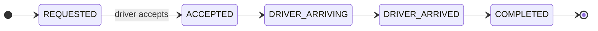

 

  

  

<a href="#-featured-project">Featured</a> ·
<a href="#-things-ive-built">Projects</a> ·
<a href="#-what-i-work-with">Stack</a> ·
<a href="#-github-stats">Stats</a>

---

## 👋 About me

I'm a software developer based in Lagos, Nigeria, open to full-time roles (on-site, hybrid or remote). I build backend systems and the apps that sit on top of them, mostly in Java with Spring Boot and in Python with FastAPI, plus React and React Native on the front.

I try to build everything the way I'd want to maintain it six months later: small classes, clear layers, validation on the server, and tests for the logic that matters. Most of my repos are things I actually wanted to exist, not just exercises.

---

## ⭐ Featured project

### 🚗 Go: ride-hailing backend and mobile app

A ride-hailing platform with a **Spring Boot** API and an **Expo / React Native** app. Riders book rides, drivers accept them, and payments run through **Paystack**.

| | |
| --- | --- |
| **Backend** | Java 21, Spring Boot, MongoDB, JWT authentication, Docker and docker-compose |
| **Mobile** | TypeScript, Expo, React Native, Expo Router, maps and location, Zustand for state |
| **Auth** | Separate rider and driver registration, login with a bearer token, driver licence and plate captured at sign-up |
| **Rides** | Book, accept, update status, cancel, and ride history for both riders and drivers |
| **Payments** | Paystack checkout and verification, a webhook for payment events, and a direct or cash option; runs in sandbox mode without live keys |
| **Design** | Class diagram and use case diagram included in the repo |

[**View the repo →**](https://github.com/RyanAAQ/RideHailingApp)

---

## 🛠 Things I've built

### 🎫 Helpdesk Support System (built twice)

A ticketing app where customers report problems and support staff work through them. Customers, agents and admins each get different permissions, tickets carry a priority and move through `OPEN → IN_PROGRESS → RESOLVED → CLOSED`, and every ticket keeps its own comment thread. After login there's a dashboard with ticket stats.

| Version | Stack | Repo |
| --- | --- | --- |
| **Java** | Spring Boot, MongoDB, layered controllers / services / repositories, HTML, CSS and JavaScript front end | [HelpDesk_Support_maven](https://github.com/RyanAAQ/HelpDesk_Support_maven) |
| **Python** | FastAPI, SQLModel, MySQL or SQLite, bcrypt for passwords, managed with `uv`, plus a front end | [Helpdesk_python_core](https://github.com/RyanAAQ/Helpdesk_python_core) |

Both started from class and use case diagrams drawn before any code was written.

### 💊 ourChemo: pharmacy inventory manager

**Spring Boot 3 + MongoDB** on the back and **React 18 + TypeScript + Vite** on the front. A chemist logs in, adds drugs with batches and expiry dates, dispenses from a cart (stock drops automatically and the API refuses a sale it can't cover), and looks back through every past sale with revenue totals. The service layer has JUnit tests for authentication and for inventory and dispensing.
[View the repo →](https://github.com/RyanAAQ/OurChemo)

### 🧾 Quick Invoice API

A REST API for creating and managing invoices, built with **Spring Boot, Spring Data JPA and PostgreSQL**. The server works out line totals, subtotal and final total itself, so a bad request can't produce wrong numbers, and invalid input gets a `400` response that lists exactly which fields failed.
[View the repo →](https://github.com/RyanAAQ/Money_Making_machine)

### 🤝 Goodturn: community support directory for Lagos

A directory of community support services with listings carrying category, area, provider contacts and verification dates. It comes as both a **web app** and a **command-line tool** (`my-ai list`, `my-ai search`), written in Python with tests, and it needs no paid external APIs.
[View the repo →](https://github.com/RyanAAQ/goodturn)

### 💇🏾‍♀️ Make Me Beauty Place

A responsive **React + Vite** redesign concept for a beauty salon in Surulere, Lagos, built as a pitch for a real local business. It has services, product categories, a gallery, WhatsApp booking and a Google Maps link, in a cream, blush and gold look.
[View the repo →](https://github.com/RyanAAQ/BeautyPlace)

### 💬 Secure Messaging App for Nigeria *(in progress)*

A private, end-to-end encrypted chat app made for the Nigerian market, with phone-number sign-in by SMS OTP, real-time one-to-one chat with delivered and read receipts, and offline-first behaviour for patchy, low-bandwidth connections.

### 🧱 Custom ArrayList (Java)

My own `ArrayList` written from scratch with strict TDD: red, green, refactor, tested with JUnit 5.

---

## 🧰 What I work with

  

**Right now I'm getting better at:** testing and TDD, UML and system design, and using design patterns in real code instead of just on slides.

---

## 📊 GitHub stats

  
  

  

<b>📈 Activity graph</b>

 

  

<b>📚 More repositories: practice and coursework</b>

 

| Repo | What's in it |
| --- | --- |
| [Codveda](https://github.com/RyanAAQ/Codveda) | Java programs across three levels: calculator, number guesser, bank app, employee management, chat app and tree nodes |
| [RegexPattern](https://github.com/RyanAAQ/RegexPattern) | Java regex exercises with tests |
| [SQL_tasks](https://github.com/RyanAAQ/SQL_tasks) | SQL exercises |
| [JavaScript-IDE](https://github.com/RyanAAQ/JavaScript-IDE) | JavaScript practice |
| [Java-Tasks](https://github.com/RyanAAQ/Java-Tasks) · [Java_Weekend_Tasks](https://github.com/RyanAAQ/Java_Weekend_Tasks) · [Array_tasks](https://github.com/RyanAAQ/Array_tasks) | Java exercises and data structure practice |
| [PythonTasks](https://github.com/RyanAAQ/PythonTasks) · [Python2_Tasks](https://github.com/RyanAAQ/Python2_Tasks) · [JavaScript_Tasks](https://github.com/RyanAAQ/JavaScript_Tasks) | Python and JavaScript exercises |

## 🐍 Contribution snake

  

---

*Currently focused on writing cleaner tests and shipping projects people can actually use.*

